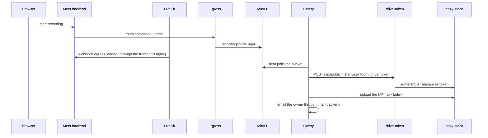

# Meet recordings

A meeting recorded in Meet goes to the Drive of the user who started it, in `Meetings/Meeting - <date> - <room>/`, and that user gets an email when it is there. `meet_app` runs LinTO's fork of Meet (`ghcr.io/linto-ai/meet-backend:v1.42`) for this. Transcription and summary stay off.

## How a recording reaches the Drive

- The Drive is the user's `workspaceUrl` in LDAP. LemonLDAP sends it to Meet as the `workplaceFqdn` claim, and Meet stores it at login.
- drive-token stands in for the Cloudery route `drive_token` that the fork calls. It asks the cozy-stack admin API for a `cli` token scoped to `io.cozy.files`. It only answers for instances under `BASE_DOMAIN` and is reachable on `twake-network` only.
- The LiveKit webhook goes through `visio-frontend`, which marks it https: the backend redirects plain http.

## What it needs

- `cozy_stack` and twake_db's MinIO. `./wrapper.sh up --meet` starts them.
- `tmail_app` for the email. Without it the MP4 still reaches the Drive, but the recording ends as `notification_failed`.
- The user's instance must resolve from `visio-backend` and `visio-celery`. Their `extra_hosts` list user1 to user3 and the demo organization's instances. A user added later needs a line there.
- On a stack that ran before this change, recreate `twake_auth` so LemonLDAP sends the new claim, then log out of Meet and back in.

## Certificates

Python 3.13 rejects a CA without the keyUsage extension, and the self-signed root from `generate-cert.sh` has none. `meet_app/compose-wrapper.sh` re-signs the same root (same key and subject) with keyUsage into `meet_app/config/root-ca.crt`. `SSL_CERT_FILE` points the backend and Celery at it, which replaces their system CA bundle.

## Troubleshooting

- The record button stays on "Starting…": the backend gets no LiveKit webhook. Check `docker logs visio-livekit` for the webhook call and its status.
- `visio-livekit` restarts with `field allow_restricted_peer_cidrs not found`: the local image is an old build. Run `sudo docker compose build livekit` in `meet_app`.
- The MP4 is in MinIO but not in the Drive: `docker logs visio-celery` names the failing step (drive token, TLS, upload).

## Open question

- With `CERT_MODE=letsencrypt`, `root-ca.crt` holds the Let's Encrypt chain, not a root, and `SSL_CERT_FILE` replaces the system bundle. Does the Drive upload still verify? Not tested.
